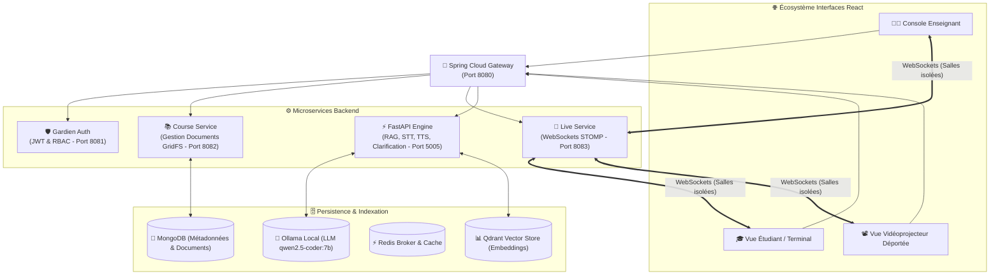

# 🎓 AI Pedagogical Assistant — Distributed Multi-Screen Real-Time Teaching Platform

> An intelligent distributed platform for university lectures and seminar sessions. Features real-time voice assistance, domain-agnostic contextual RAG, a visual image clarification agent powered by local lightweight AI models (Ollama), and seamless multi-screen synchronization (instructor, students, and video projector).

---

## 🏛️ Vue d'Ensemble de l'Architecture

Le projet repose sur une **architecture microservices distribuée** combinant la robustesse de **Java Spring Boot**, la flexibilité de **FastAPI (Python)** pour l'intelligence artificielle, et la réactivité de **React (Vite)** côté client.



---

## ✨ Fonctionnalités Clés

### 1. 🤖 Intelligence Artificielle 100% Locale & Économe en RAM
- **Modèle local par défaut** : `qwen2.5-coder:7b` via Ollama (~4,7 Go de VRAM) pour une inférence fluide sans saturer les machines hôtes.
- **RAG Multi-Domaines Agnostique** : Moteur de recherche vectorielle et sémantique sur Qdrant (ColPali / ColBERT / Embeddings denses) s'adaptant à n'importe quel cours (informatique, droit, médecine, mathématiques, etc.) à partir des supports PDF partagés par l'enseignant.
- **Synthèse et Reconnaissance Vocale** : Système audio double-couche intégrant Whisper et synthèse vocale locale optimisée pour macOS et navigateurs web standards.

### 2. 🎨 Clarification Visuelle d'Images & Pédagogie Active
Lorsqu'un étudiant exprime une incompréhension sur un schéma ou un visuel projeté :
1. **Détection d'intention** et recherche d'illustrations alternatives pertinentes.
2. **Validation par l'enseignant** de l'image la plus pédagogique d'un simple clic.
3. **Explication sur-mesure** générée par l'IA faisant le lien direct entre la question de l'élève, la diapositive originale et le nouveau visuel.
4. **Diffusion instantanée** de l'image agrandie et de son explication audio/textuelle sur les écrans des étudiants et le projecteur via WebSocket.

### 3. 📡 Synchronisation Temps Réel Multi-Écrans
- **Isolation stricte par salle de cours** (`LiveSessionHandler` avec `ConcurrentHashMap`) empêchant toute collision entre amphithéâtres ou groupes de TD.
- **Canal de synchronisation matériel** (`BroadcastChannel`) permettant d'ouvrir la vue vidéoprojecteur sur un second écran sans latence réseau.
- **Surlignage synchronisé** : Les passages du support mentionnés à l'oral sont automatiquement mis en valeur en temps réel.

### 4. 🧹 Maintenance & Hygiène Système Automatique
- **Garbage Collector Audio** : Nettoyage périodique et sécurisé des fichiers audio temporaires (TTS) obsolètes pour préserver l'espace disque.
- **Purge en cascade** : Gestion propre des suppressions de comptes, documents et vecteurs orphelins.

---

## 📁 Structure du Répertoire

```text
test-microservices/
├── docker-compose.yml          # Orchestration unifiée des services et bases de données
├── .env.example                # Modèle des variables d'environnement
├── Gateway/                    # Passerelle Spring Cloud Gateway
├── Gardien/                    # Service d'authentification et de sécurité
├── course-service/             # Gestionnaire des cours et fichiers GridFS
├── live-service/               # Service WebSocket temps réel pour les sessions live
├── FastAPI/                    # Cœur IA (Agents RAG, Vision, Vocal et MLOps)
│   ├── services/agents/        # ImageClarifier, VoiceUtils, RAG
│   ├── services/core/          # SmartCourseNavigator, Orchestrator
│   └── OllamaService/          # Connecteurs locaux Ollama
└── Interfaces/                 # Frontend React 18, TailwindCSS et Vite
    └── src/pages/              # CourseSession, PDFProjectorView, Dashboards
```

---

## 🚀 Démarrage Rapide

### Prérequis
- **Docker** & **Docker Compose**
- **Ollama** installé avec le modèle compact :
  ```bash
  ollama pull qwen2.5-coder:7b
  ```
- **Node.js** (v18+) et **Java** (OpenJDK 21) pour le développement local.

### 1. Configuration des Environnements
Copiez le modèle de configuration :
```bash
cp .env.example .env
cp .env.example FastAPI/.env
```

### 2. Lancement Global via Docker Compose
```bash
docker compose up -d
```
Les services seront accessibles sur :
- **Interface Web** : `http://localhost:5173`
- **Passerelle API (Gateway)** : `http://localhost:8080`
- **Moteur IA FastAPI** : `http://localhost:5005`
- **Base Vectorielle Qdrant** : `http://localhost:6333`
- **Base Documentaire MongoDB** : `http://localhost:27017`

---

## 👨‍💻 Auteur

**Mourad Daghfous**  
GitHub : [@daghfousmourad-dotcom](https://github.com/daghfousmourad-dotcom)  
Projet de Fin d'Études (PFE) — Informatique & Systèmes Intelligents Répartis.
